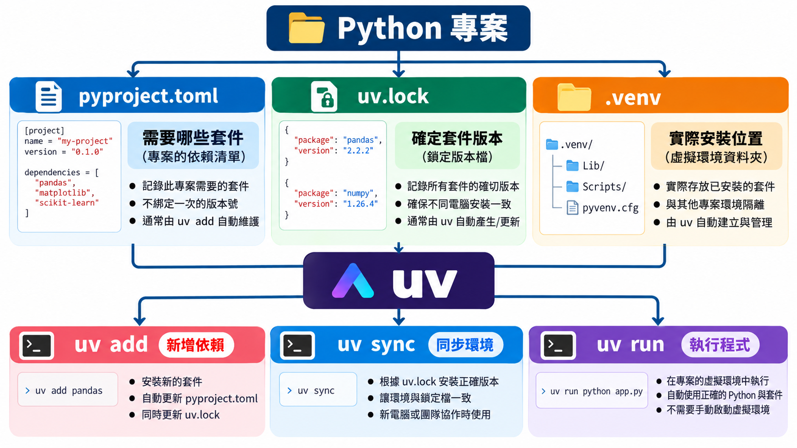

# Python 虛擬環境：從 0 開始使用 uv

## 為什麼需要虛擬環境？

假設電腦裡有兩個 Python 專案：

```text
電腦
│
├── 專案 A：資料分析
│   ├── pandas
│   └── matplotlib
│
└── 專案 B：網站開發
    ├── fastapi
    └── uvicorn
```

如果所有套件都直接安裝到電腦的 Python 裡，時間久了很容易遇到一個問題：

```text
所有專案
   ↓
共用同一個 Python
   ↓
套件全部混在一起
```

更麻煩的是「版本衝突」。例如：

```text
專案 A
└── 需要 pandas 2.2

專案 B
└── 需要 pandas 3.x
```

兩個專案需要不同版本，卻共用同一套環境，就可能互相影響。

所以實務上通常會變成：

```text
專案 A
├── 程式碼
└── .venv
    ├── pandas
    └── matplotlib

專案 B
├── 程式碼
└── .venv
    ├── fastapi
    └── uvicorn
```

每個專案都有自己的環境。這就是**虛擬環境(Virtual Environment)**。

## uv 是什麼？

傳統 Python 開發時，你可能會陸續碰到：

```text
python
pip
venv
requirements.txt
virtualenv
pyenv
pip-tools
```

對初學者來說很容易搞混：

```text
我要建立環境用誰？
我要裝套件用誰？
我要管理 Python 版本又用誰？
```

uv 把很多常見工作整合在一起。

例如：

```text
uv python     → 管理 Python
uv venv       → 建立虛擬環境
uv init       → 建立專案
uv add        → 安裝並記錄專案套件
uv remove     → 移除套件
uv sync       → 同步專案環境
uv run        → 在專案環境執行程式
```

## 安裝uv

開啟 VS Code Terminal：

```shell
powershell -ExecutionPolicy ByPass -c "irm https://astral.sh/uv/install.ps1 | iex"
```

如果遇到 PowerShell 執行權限問題

```shell
Set-ExecutionPolicy -ExecutionPolicy RemoteSigned -Scope CurrentUser
```

確認 uv 是否安裝成功

```powershell
uv --version
```

## 用 uv 管理 Python

查看目前可以使用的 Python：

```powershell
uv python list
```

如果想安裝 Python 3.12：

```powershell
uv python install 3.12
```

卸載

```powershell
uv python uninstall 3.11
```

## 自己建立第一個虛擬環境

假設現在有：

```text
D:\github\python-demo
```

進入資料夾：

```powershell
cd D:\github\python-demo
```

初始化 uv 專案

```shell
uv init

# 這時 uv 會建立專案需要的基本檔案，例如：
# python-demo/
# │
# ├── .gitignore
# ├── .python-version
# ├── README.md
# ├── main.py
# └── pyproject.toml
```

其中pyproject.toml代表「這是一個由 uv 管理的 Python 專案」，之後安裝哪些套件、需要哪個 Python 版本，都會跟專案設定產生關係。

接著建立虛擬環境：

```powershell
uv venv
# 如果指定 Python 3.12：
# uv venv --python 3.12
```

## 啟動虛擬環境

Windows PowerShell：

```powershell
.venv\Scripts\activate
# 成功後 Terminal 前面通常會出現：
# (.venv) PS D:\github\python-demo> # (.venv)代表目前 Terminal 已經進入虛擬環境。
```

離開環境則輸入：

```powershell
deactivate
```

### 補充：其實使用 uv，不一定要手動 activate

很多初學者會以為一定要 activate才能使用虛擬環境。但其實你執行

```powershell
uv run python main.py
```

uv 會直接使用專案環境執行。

也就是：

```text
uv run
  ↓
找到專案
  ↓
確認 .venv 與依賴
  ↓
使用正確環境
  ↓
執行程式
```

## 安裝套件：`uv add`

```powershell
# 假設專案需要 pandas：
uv add pandas
```

## 移除套件：`uv remove`

```powershell
# 例如不要 pandas：
uv remove pandas
```

## 把環境同步回來：`uv sync`

這個指令在多人合作時非常重要：

```powershell
uv sync
```

假設今天你從 GitHub 把老師的專案抓下來：

```text
python-data-science/
│
├── pyproject.toml
├── uv.lock
├── notebooks/
└── ...
```

但通常 GitHub **不會上傳 `.venv`**。

所以學生電腦可能是：

```text
有程式碼
有 pyproject.toml
有 uv.lock

但是
沒有老師電腦裡的虛擬環境
```

這時執行：

```powershell
uv sync
```

uv 就會根據專案設定建立或更新環境。官方說明也指出，第一次執行 `uv sync`、`uv run` 或 `uv lock` 等專案指令時，uv 會按需要建立 `.venv` 與 lockfile。:chatgpt-content-reference{index="12"}

所以你現在教學生的流程：

```powershell
git pull
uv sync
```

## `uv.lock` 是什麼？

`pyproject.toml` 和 `uv.lock` 很容易搞混。

- pyproject.toml：專案需求，我要哪些套件
- uv.lock：最後決定使用哪些版本？
- .venv：實際把這些套件裝在哪裡？

## 一套可以直接讓學生背的工作流程

### 自己建立新專案

```powershell
mkdir my-project
cd my-project

uv init
uv init
uv add pandas numpy matplotlib
uv run python main.py
```

### 接手別人的專案

```powershell
git clone 專案網址
cd 專案

uv sync
uv run python main.py
```

### 老師更新 GitHub 後

```powershell
git pull
uv sync
```

接著正常上課。

## 最重要的觀念圖



<p style="text-align: center;">Copyright © 2026 Wei-Cheng Chen</p>
